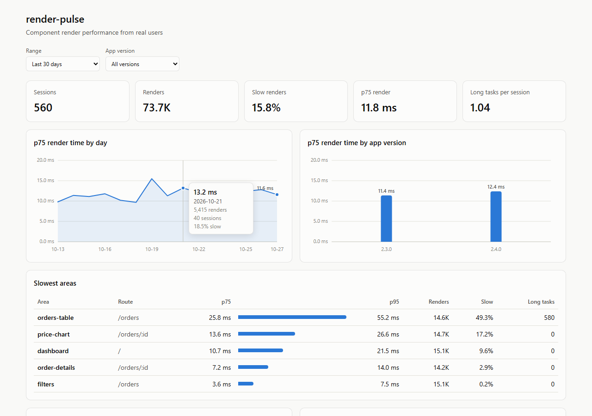

<div align="center">

# react-render-pulse

**Find the React components that slow your app down — on real users' devices.**

Lightweight, privacy-friendly render performance monitoring for React in production.

[](https://www.npmjs.com/package/react-render-pulse)
[](https://bundlephobia.com/package/react-render-pulse)
[](./LICENSE)
[](https://github.com/Amalmktk/react-render-pulse/actions/workflows/ci.yml)
[](https://www.typescriptlang.org/)

[Getting started](#getting-started) · [How it works](#how-it-works) · [API](#api) · [What we collect](#what-we-collect) · [Roadmap](#roadmap) · **[Docs](https://amalmktk.github.io/react-render-pulse/)**

</div>

---

## Why react-render-pulse?

React DevTools shows you how your app performs **on your machine**.
react-render-pulse shows you how it performs **for your users**.

Development builds behave differently from production, and a fast laptop hides problems that users on budget phones face every day. react-render-pulse measures render performance in production, from real sessions, so you know exactly which components to optimize first.

- 🔍 **Component-level insight** — render durations, re-render counts, and long main-thread tasks, per area of your app and per route
- 🪶 **Tiny overhead** — about 10 µs per measured render in lightweight mode, a ~3.6 kB client, sampled sessions, and in-memory aggregation
- 🔒 **Privacy-friendly** — no user IDs, no IP addresses, no page text, no input values, no query strings
- ⚙️ **Two modes** — precise _profiling mode_ for a sampled group, or _lightweight mode_ for every production build
- 🧩 **Bring your own backend** — send data to your own endpoint, use the collector package, or export to OpenTelemetry
- 🟦 **TypeScript-first** — fully typed API



<sub>The web viewer, showing synthetic demo data.</sub>

## Getting started

### Install

```bash
npm install react-render-pulse
# or
pnpm add react-render-pulse
# or
yarn add react-render-pulse
```

React 18 or 19 is a peer dependency.

### 1. Initialize once

Call `initRenderPulse` at your app's entry point, before it renders:

```tsx
import { initRenderPulse } from "react-render-pulse";

initRenderPulse({
  endpoint: "/api/render-pulse", // where batches are sent
  sampleRate: 0.05, // monitor 5% of sessions
});
```

### 2. Wrap the areas you care about

```tsx
import { RenderMonitor } from "react-render-pulse";

export function OrdersPage() {
  return (
    <RenderMonitor id="orders-page">
      <Filters />
      <RenderMonitor id="orders-table">
        <OrdersTable />
      </RenderMonitor>
    </RenderMonitor>
  );
}
```

Or track a single component with a hook:

```tsx
import { useRenderMonitor } from "react-render-pulse";

function PriceChart() {
  useRenderMonitor("price-chart");
  return <Chart />;
}
```

### 3. See the results

Leave out `endpoint` during development and every batch is logged to the console as a table. In production, data is sent to your `endpoint`. Use the [collector](#collector-and-viewer) to store it and the viewer to explore it.

## How it works

```
 Sample → Measure → Aggregate → Deliver → Collect → View
```

The [Architecture guide](https://amalmktk.github.io/react-render-pulse/guide/architecture) covers each step in detail.

1. **Sample** — once per session, decide whether to monitor it. Unsampled sessions do almost nothing.
2. **Measure** — record render durations and counts for each monitored area, and observe long tasks and long animation frames on the main thread.
3. **Aggregate** — keep compact summaries in memory (counts, histograms, percentiles, worst cases), never raw event streams.
4. **Deliver** — when the page is hidden (and every few minutes while it's open), send one small batch with `navigator.sendBeacon`, falling back to `fetch` with `keepalive`, with retries and a size limit.
5. **Collect** — your endpoint, or the collector package, validates and stores the data.
6. **View** — find the slowest areas, the worst devices, and trends by day and app version.

### Profiling mode vs. lightweight mode

|                 | Profiling mode                                     | Lightweight mode                                |
| --------------- | -------------------------------------------------- | ----------------------------------------------- |
| How it measures | React's Profiler (actual render time per subtree)  | Timing markers around each area + long-task data |
| Requires        | React's profiling build                            | Nothing special                                 |
| Accuracy        | High, per subtree, including updates inside it     | Per area; updates that start inside an area aren't seen |
| Overhead        | Higher (it's React's profiling build's own cost)   | Very low (~10 µs per measured render)           |
| Best for        | A small sampled group or staging                   | All production users                            |

With `mode: "auto"` (the default), react-render-pulse uses profiling mode when React's profiling build is detected, and lightweight mode otherwise. See the [modes guide](https://amalmktk.github.io/react-render-pulse/guide/modes) for setup steps for Vite and Next.js.

## API

### `initRenderPulse(options)`

| Option            | Type                                     | Default                    | Description                                                      |
| ----------------- | ---------------------------------------- | -------------------------- | ---------------------------------------------------------------- |
| `endpoint`        | `string`                                 | —                          | URL that receives data batches                                   |
| `sampleRate`      | `number` (0–1)                           | `1`                        | Fraction of sessions to monitor, decided once per page load      |
| `mode`            | `"auto" \| "profiling" \| "lightweight"` | `"auto"`                   | Measurement mode                                                 |
| `slowRenderMs`    | `number`                                 | `16`                       | Renders slower than this are counted as slow (about one frame)   |
| `longTaskMs`      | `number`                                 | `50`                       | Main-thread tasks longer than this are recorded                  |
| `appVersion`      | `string`                                 | —                          | Your app's version, for comparing releases                       |
| `getRoute`        | `() => string`                           | path, numbers → `:id`      | Returns the current route; normalize IDs here                    |
| `flushIntervalMs` | `number`                                 | `180000`                   | Also send while the page is open; `0` sends only on page hide    |
| `exporters`       | `Exporter[]`                             | —                          | Receive measurements and batches, e.g. `createOtelExporter`      |
| `debug`           | `boolean`                                | `true` without `endpoint`  | Log batches and internal errors to the console                   |

`initRenderPulse` returns `{ sampled, mode, flush(), destroy() }`. More options (payload size and area limits) are in the [API reference](https://amalmktk.github.io/react-render-pulse/api/client).

### `<RenderMonitor id="..." />`

Wraps a part of your component tree and measures it as one area. Areas can be nested; an outer area's time includes its inner ones.

| Prop       | Type        | Description                        |
| ---------- | ----------- | ---------------------------------- |
| `id`       | `string`    | A stable, unique name for the area |
| `children` | `ReactNode` | The components to measure          |

### `useRenderMonitor(id)`

Measures a single component's renders. Render counts are exact; durations run from the component's render to the commit, so they're an upper bound.

### `createOtelExporter({ meter })`

From `react-render-pulse/otel`. Records every measurement as OpenTelemetry metrics. See the [OpenTelemetry guide](https://amalmktk.github.io/react-render-pulse/guide/opentelemetry).

## What we collect

react-render-pulse is designed to collect **performance data only**. A batch looks like this (trimmed):

```json
{
  "v": 1,
  "session": { "id": "5f0c9a1e-…", "seq": 1, "mode": "lightweight", "route": "/orders", "appVersion": "2.4.0" },
  "device": { "memoryGb": 4, "cores": 8, "connection": "4g", "viewport": "390x844" },
  "summary": { "renders": 42, "slowRenders": 5, "longTasks": 3, "longTaskMs": 400 },
  "areas": [
    { "id": "orders-table", "route": "/orders", "renders": 42, "slow": 5, "p50": 6.1, "p75": 11.8, "p95": 38.2, "hist": [] }
  ],
  "longTasks": [{ "area": "orders-table", "route": "/orders", "count": 3, "maxMs": 212 }]
}
```

The session `id` is random per page load and never stored on the device, so it can't identify a user. Every field is listed in [What we collect](https://amalmktk.github.io/react-render-pulse/guide/what-we-collect).

**Never collected:** user IDs, IP addresses (by the client), cookies, page text, input values, or URLs' query strings. The collector rejects payloads with any field it doesn't expect.

> Your collector or hosting provider may still log request metadata such as IP addresses. Check your own server and privacy policy. The default `getRoute` only replaces numeric path segments; if your paths contain other IDs (UUIDs, usernames), normalize them in `getRoute`.

## Collector and viewer

Companion packages store and explore your data:

```ts
// api/render-pulse.ts (for example, a Vercel function)
import { createCollector } from "react-render-pulse-collector";
import { postgresStorage } from "react-render-pulse-collector/postgres";

const collect = createCollector({
  storage: postgresStorage({ url: process.env.DATABASE_URL ?? "" }),
});

export const POST = collect;
export const OPTIONS = collect;
```

```bash
npx react-render-pulse-viewer report batches.jsonl     # terminal report
npx react-render-pulse-viewer serve --db "$DATABASE_URL"   # web viewer
```

The collector also stores to a JSON Lines file (`react-render-pulse-collector/json-file`) and runs on Express or plain Node (`react-render-pulse-collector/node`). Postgres keeps each batch as `jsonb`, so you can also query it with SQL.

**[Collecting results](https://amalmktk.github.io/react-render-pulse/guide/collecting-results)** walks through it end to end: choosing where data goes, deploying a collector, checking data arrives, reading it with the viewer, ready-made SQL queries, and troubleshooting. See also the [collector guide](https://amalmktk.github.io/react-render-pulse/guide/collector) and the [viewer guide](https://amalmktk.github.io/react-render-pulse/guide/viewer).

## Framework guides

- [Vite + React](https://amalmktk.github.io/react-render-pulse/guide/frameworks#vite)
- [Next.js App Router](https://amalmktk.github.io/react-render-pulse/guide/frameworks#next-js-app-router) and [Pages Router](https://amalmktk.github.io/react-render-pulse/guide/frameworks#next-js-pages-router)
- [React Router](https://amalmktk.github.io/react-render-pulse/guide/frameworks#react-router)

Each has a working app in [`examples/`](./examples).

## Performance

A performance tool shouldn't hurt performance. Overhead is measured on every pull request against a benchmark app and must stay within a fixed budget ([`bench/budget.json`](./bench/budget.json)).

| Mode        | Added render time                                                         | Bundle size (min + brotli) |
| ----------- | ------------------------------------------------------------------------- | -------------------------- |
| Lightweight | ~0.006–0.014 ms per measured render (+4–11% in a render-only benchmark)    | 3.6 kB                     |
| Profiling   | ~0.07–0.08 ms per measured render — about the same as a bare React `<Profiler>` | 3.6 kB (+ React's profiling build) |

Chromium, no CPU throttling, October 2026. The same runs check accuracy: components with a known cost of 2, 8 and 20 ms are reported as 2, 8 and 20 ms in both modes. See [Performance](https://amalmktk.github.io/react-render-pulse/guide/performance) for how these numbers are measured and how to reproduce them, and [decision 001](https://amalmktk.github.io/react-render-pulse/decisions/001-modes) for how the budget was set.

## Comparison

|                               | react-render-pulse | React DevTools Profiler | Full monitoring platforms |
| ----------------------------- | :----------------: | :---------------------: | :-----------------------: |
| Works in production           |         ✅         |           ❌            |            ✅             |
| Component-level render data   |         ✅         |           ✅            |          Limited          |
| Data from real users' devices |         ✅         |           ❌            |            ✅             |
| Self-hosted, no subscription  |         ✅         |           ✅            |        Usually ❌         |
| Lightweight, React-focused    |         ✅         |           ✅            |            ❌             |

## Roadmap

- [x] **v1.0** — `RenderMonitor`, `useRenderMonitor`, lightweight and profiling modes, long tasks, delivery, collector package, CLI and web viewer, OpenTelemetry export, React version matrix
- [ ] **v1.5** — slow interaction attribution, separate first-render and update timings, release comparisons, CI regression checks, alerts

See the full roadmap in [ROADMAP.md](./ROADMAP.md).

## Contributing

Contributions are welcome! Please read [CONTRIBUTING.md](./CONTRIBUTING.md) to get started.

```bash
git clone https://github.com/Amalmktk/react-render-pulse.git
cd react-render-pulse
pnpm install
pnpm build
pnpm test
```

Found a bug or have an idea? [Open an issue](https://github.com/Amalmktk/react-render-pulse/issues).

## Security

Please report security issues privately as described in [SECURITY.md](./SECURITY.md).

## License

[MIT](./LICENSE) © Amal M
