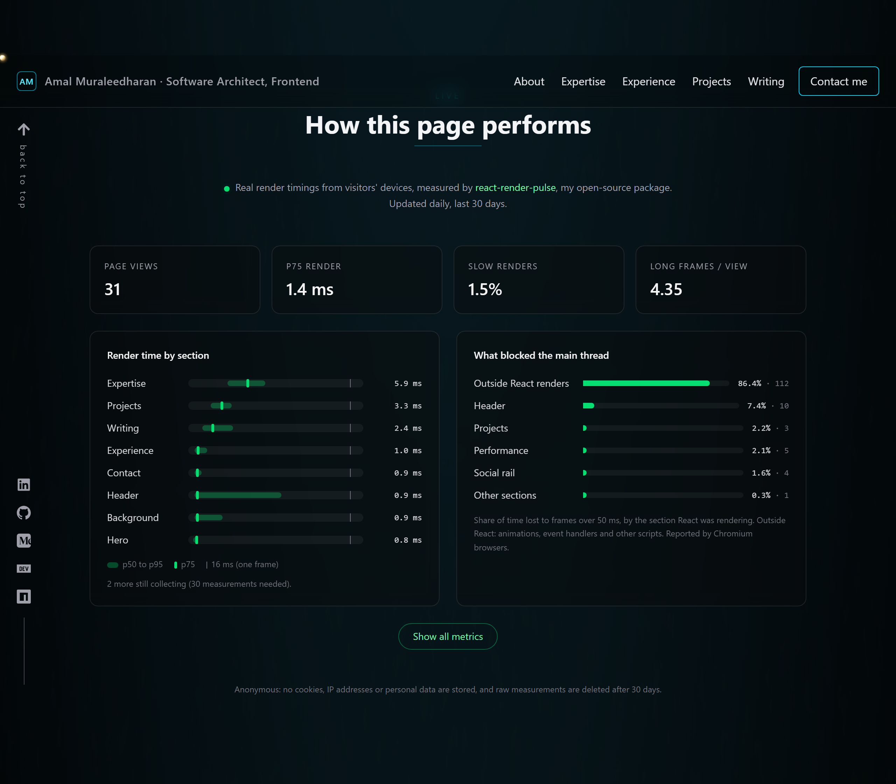
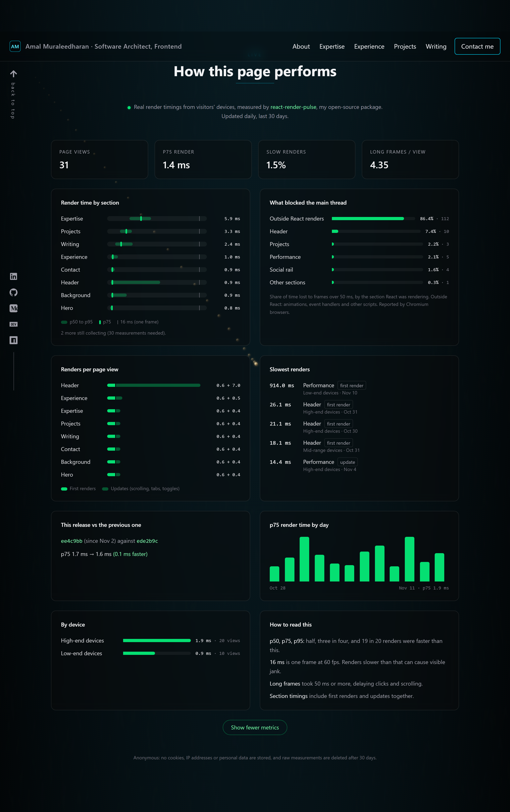

# I Pointed My React Performance Tool at My Own Portfolio. The First Problem It Found Was Mine.

*Measuring which components are slow on real visitors' devices, and what happened when I tried it on my own site.*

<!-- Publishing notes (delete before posting):
- Numbers are from https://www.itzamal.in/api/render-pulse-stats, 2026-10-28 to 2026-11-11. Refresh them before posting.
- Images: blog/images/live-metrics-overview.png and live-metrics-all.png (captured 2026-11-12). Upload them to Medium by hand.
- Medium does not convert Markdown on paste. Preview this file in VS Code (Ctrl+Shift+V) and copy from the preview; for code blocks type ``` on a new line in Medium.
- Tags: React, JavaScript, Web Performance, Frontend, Open Source.
-->

---

Every React performance tool I've used answers the question on **my** machine. React DevTools' Profiler, Lighthouse and the Performance panel all run on a fast laptop with a warm cache and nothing else open.

My visitors don't browse like that. Some are on a four-year-old Android phone over a train's 4G connection. When they say a page "feels slow", I want to know which **component** was slow for **them**.

General real-user monitoring tools tell you the page was slow. They don't tell you it was the orders table, or that it only happens on low-end phones. React's own `<Profiler>` can tell you which component it was, but only in a special profiling build you wouldn't ship to everyone.

So I built **react-render-pulse**: a small library that measures render times of the React components you choose, on real users' devices, in a normal production build.

Then I did the obvious thing and pointed it at my own portfolio. This post covers how it works, how I set it up, and what two weeks of data showed. Spoiler: the first problem it found was in my own setup.

## How you measure a render without React's profiling build

React renders a component tree in order, top to bottom, in one synchronous pass. That gives a cheap trick: put an invisible component before and after the part you care about, and note the time when each one renders.

```tsx
<RenderMonitor id="experience">
  {/* StartMarker renders here: start = performance.now() */}
  <Experience />
  {/* EndMarker renders here:   end   = performance.now() */}
</RenderMonitor>
```

`end - start` is how long React spent rendering everything in between. A few details make it accurate:

- **Only committed renders count.** React sometimes starts a render and throws it away. The time is recorded in a layout effect, which only runs when React commits the render to the screen.
- **First renders and updates are tracked separately.** The first render is a *mount*; every one after it is an *update*.
- **It's cheap.** In benchmarks it costs about **0.01 ms per measured render**, and the client is **under 4 kB gzipped**.
- **If React's profiling build is present**, it switches to React's own `<Profiler>` timings automatically.

There's also a hook, `useRenderMonitor("header")`, for when wrapping isn't convenient. Hold on to that one; it comes back later.

## Which component froze the page?

Render times are half the picture. The other half is the moments the page freezes: frames that take more than 50 ms, when scrolling stutters and clicks feel ignored.

Chromium browsers report these through the Long Animation Frames API. On its own, that only tells you *that* the page froze. react-render-pulse keeps a short record of recent render windows. When the browser reports a long frame, it checks which monitored component was rendering at that moment and blames it.

If nothing was rendering, the frame is counted as **outside React renders**. That bucket is useful too: it means the problem is an animation, an event handler or a third-party script, not React.

## Getting the data off the device, privately

Sending every render to a server would be expensive and invasive. The browser summarises instead. For each component, it counts how many renders fell into each of 16 time ranges (0–1 ms, 1–2 ms, 2–4 ms … over 1 s). This is a histogram.

Histograms from thousands of visitors can simply be added together, and percentiles computed from the total come out correct. You can't do that by averaging each visitor's percentiles.

When the visitor leaves the page, one small JSON batch goes out with `navigator.sendBeacon`, which survives the tab closing and doesn't slow anything down.

The batch contains no user id, IP address, cookie or page text. Each page load gets a random id that is never stored on the device.

## Setting it up on my portfolio

My portfolio is a Vite + React 19 site on Vercel. The client setup is one call:

```ts
import { initRenderPulse } from "react-render-pulse";

initRenderPulse({
  endpoint: "/api/render-pulse",
  appVersion: import.meta.env.VITE_VERCEL_GIT_COMMIT_SHA?.slice(0, 7),
});
```

Then I wrapped each section of the home page in `<RenderMonitor>`.

The server side is the companion package, **react-render-pulse-collector**. It's a standard `Request → Response` handler, so it runs as a Vercel Function as-is. It validates every batch against a strict schema, checks the origin, limits the size and passes it to storage. I store it in Postgres (Neon's free tier).

To keep it private and cheap, I made a few choices:

- **Only coarse classes are stored:** low, mid or high-end device, and mobile, tablet or desktop. No session ids, IPs or exact device specs.
- **Raw data is deleted after 30 days.** A nightly job rolls it up into daily summaries first.
- **Each visitor can send 5 batches per 10 minutes.** The rate limit uses a salted hash of the IP and never stores the IP itself.

The results appear live on the home page, in a section called "How this page performs". It shows render times per section, what blocked the main thread, the slowest renders, and a comparison between the current deploy and the previous one.



## What the first two weeks showed

The numbers are small: **31 page views** between October 28 and November 11. I'll say that upfront rather than dress it up. Even so, they were enough to show something.

**The good news: the page is fast.** Three in four renders finish in about **1.4 ms**, under a tenth of a 60 fps frame. Only **1.5%** of renders take longer than one frame (16 ms). Low-end devices were no slower than high-end ones in this small sample (0.9 ms against 1.9 ms at p75).



**The suspicious part: the header.** In the first few days, the slowest renders were the header's *first* render: **26 ms** on a high-end device, **21 ms** on another, and **18 ms** on a mid-range one. The header was also blamed for several long frames, one of them **151 ms**.

My header is a logo and six links. It shouldn't take 26 ms to render anywhere.

## The first problem was my own measurement

The header was the one place I'd used the hook instead of the wrapper:

```tsx
const Header = () => {
  useRenderMonitor("header");
  // ...
};
```

The hook can't put a marker *after* the component, because a hook lives inside it. So its timer runs from the moment the header renders until React commits the whole update. The docs call this an upper bound.

What I hadn't thought through: on first load, the header is the **first thing in the app**. React renders it, then the entire page below it, then commits. So the header's "first render" timer was really timing **the whole site's first render**. The 26 ms was the whole page, not the header.

The same overlap explains the long frames. During page load, the header's measured window covered everything, so any long frame during that time was blamed on the header.

The fix is a few lines: measure the header the same way as everything else, with the wrapper inside the component.

```tsx
const Header = () => {
  const [menuOpen, setMenuOpen] = useState(false);
  // ...
  return (
    <RenderMonitor id="header">
      <header>{/* ... */}</header>
    </RenderMonitor>
  );
};
```

Putting the wrapper *inside* the component, below its `useState`, matters. The markers only run when the wrapper itself re-renders. A wrapper placed *above* a component in the tree doesn't see that component's own state updates, such as opening the menu or switching tabs. One placed inside does.

After the fix was deployed on November 2, no header render appears among the five slowest of the whole period. The header's p75 is **0.9 ms**, and it re-renders about 7 times per page view (scroll updates), which the "renders per page view" card shows at a glance.

There's a lesson for the library too. "Upper bound" in the docs is true, but it isn't enough of a warning. The docs now say it plainly: **don't use the hook in a component that renders before the rest of your app, like a header or a layout.** I only learned that by using it on a real site.

## An outlier I can't explain yet

The slowest render on the page now is a different one: the **Performance section's own first render took 914 ms on a low-end device** on November 10. The section that shows the metrics is the heaviest thing on the page, according to its own data.

I wanted to turn that into a tidy "found it, fixed it" story. I can't, yet. Here's what I did and didn't find:

- I loaded the live site in a phone-sized browser with the CPU slowed 20×. The same code gave a first render of anywhere from **16 ms to 885 ms** between runs.
- Removing the backdrop blur on the cards didn't help, and neither did removing the page's grain texture. The slow runs showed up with and without them.
- So the number isn't a stable property of that component. My working guess is that on a slow device the render gets interleaved with other work, and in lightweight mode the markers measure wall-clock time between them. I tried to reproduce that in a unit test and couldn't, so it stays a guess.

What this shows is the limit of the cheap measurement: one 914 ms sample from one visit is a lead, not a diagnosis. It's why the next version of the library is going to report how many renders fell into each range for first renders and updates separately, and why I want more than 31 visits before changing code over it.

## What's still open

The other notable number is the long frames. **86% of the main-thread time lost to frames over 50 ms happens outside any React render**, and some of those frames are up to hundreds of milliseconds. That's a real stutter, and React isn't the cause. My guesses are initial script loading and the animated canvas background on the home page. I can reproduce big outside-React frames on a throttled phone in the lab, but I haven't isolated which script it is.

Because every batch carries the deployed commit, the site will show the next fix as a before/after on the live page, measured on real visitors' devices rather than on my laptop.

## Try it

If you want to know which of your components are slow for real users, not just on your machine:

```bash
npm i react-render-pulse
```

- Docs: https://amalmktk.github.io/react-render-pulse/
- GitHub: https://github.com/Amalmktk/react-render-pulse
- The live data from my site: https://itzamal.in/#performance

It's open source and works with React 18 and 19. Feedback and issues are very welcome, especially if you find something like my header problem in your own app.
